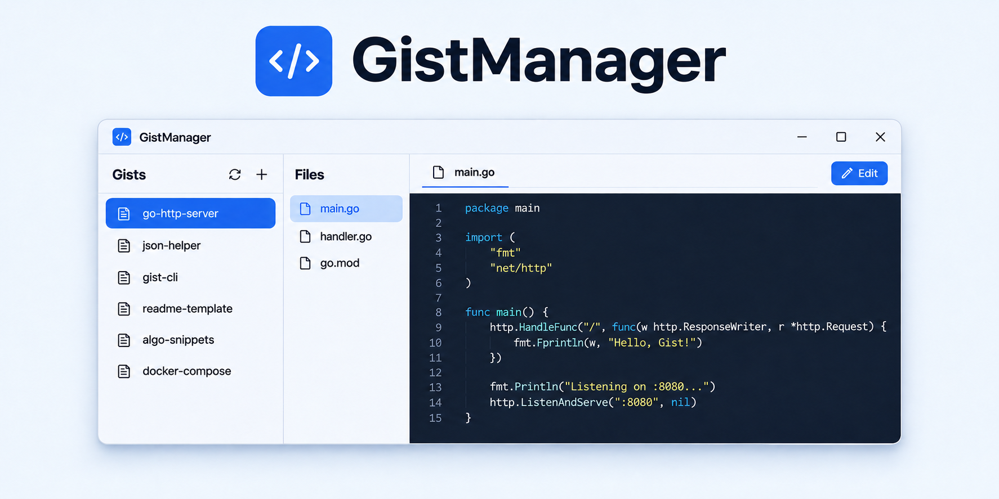

# GistManager

[](https://awesomemygo.dev/apps/gist)
[](LICENSE)



使用 Go 和 [MyGo](https://github.com/egoist/mygo) 构建的原生 GitHub Gist 桌面客户端，支持 Windows 和 macOS。

- 三栏工作区：搜索 Gist、浏览文件、编辑代码。
- 原生代码编辑器：语法高亮、查找替换、撤销重做、多光标、折叠和自动换行。
- 中文与英文界面、浅色与深色主题。
- 程序密码、系统身份验证和应用内更新。

## 下载与安装

前往 [GitHub Releases](https://github.com/Oranjekop/GistManager/releases/latest) 下载最新安装包。

| 系统 | 支持架构 | 安装方式 |
| --- | --- | --- |
| Windows 10 / 11 | x64、ARM64，安装器自动选择 | 运行合并安装器 `.exe` |
| macOS 12 及以上 | Intel、Apple Silicon | 打开 Universal `.dmg`，将应用拖入“应用程序” |

也可下载对应架构的便携 ZIP。所有安装包与便携包的校验值见 Release 中的 `SHA256SUMS.txt`。

macOS 包使用 ad-hoc 签名，首次打开可能需要在“系统设置 → 隐私与安全性”中允许。

## 开始使用

1. 在 GitHub [创建 Personal Access Token](https://github.com/settings/tokens/new?scopes=gist&description=GistManager)，授予 `gist` 权限，然后在应用中连接账号。
2. 在左侧搜索、选择 Gist，再选择文件。代码默认只读，点击“编辑”后修改并保存。
3. 使用“新建 Gist”“新增文件”、重命名和删除操作管理内容，也可打开 GitHub 页面或复制 Raw 链接。

切换文件、刷新、锁定或退出前，应用会提示处理未保存的修改。私密 Gist 不会公开列出，但持有链接的人仍可访问。

| 操作 | Windows | macOS |
| --- | --- | --- |
| 保存 | `Ctrl+S` | `Cmd+S` |
| 新建 Gist | `Ctrl+N` | `Cmd+N` |
| 刷新 | `Ctrl+R` | `Cmd+R` |
| 锁定 | `Ctrl+Shift+L` | `Cmd+Shift+L` |

## 语言与安全

界面默认跟随系统语言，也可在“系统设置 → 语言”中选择中文或 English；其他系统语言回退到英文。

GitHub Token 保存在 Windows 凭据管理器或 macOS Keychain 中。程序密码独立于 GitHub 密码；启用锁定后，可使用程序密码或设备支持的 Windows Hello / PIN、Touch ID 解锁。开启自动系统身份验证后，启动和锁定时会自动请求验证，取消后可手动重试或输入程序密码。

关闭启动锁定会保留程序密码。清除密码需要验证当前密码或通过系统身份验证；忘记密码时，可在锁定页通过系统身份验证清除。清除后关闭启动锁定与自动身份验证，保留 GitHub Token 和 Gist 数据。

## 更新

应用会检查正式更新，也可点击“检查更新”手动检查。下载包通过 SHA-256 校验后，点击“重启并安装”即可自动替换程序并重启，无需安装向导。启用启动锁定时，重启后仍需解锁。

无法使用应用内更新时，可从 [GitHub Releases](https://github.com/Oranjekop/GistManager/releases/latest) 下载安装包。

macOS 上仍使用中文应用包名的安装，需要通过 DMG 安装 `GistManager.app` 完成首次改名升级，配置会自动沿用。

## 开发与构建

安装 [Go](https://go.dev/dl/)（工具链要求见 `go.mod`）：

```sh
go mod download
go run .
```

`go tool mygo dev` 启动开发热重载；`go run . --demo` 使用隔离的内存演示数据。

```sh
go test ./... -timeout 120s
go vet ./...
```

本地构建从 `mygo.json` 读取应用版本：

```sh
go run ./cmd/release build -platform windows/universal
go run ./cmd/release build -platform darwin/universal
```

安装包分别输出至 `dist/windows-universal/` 和 `dist/darwin-universal/`。macOS 签名和 DMG 打包需在 Mac 上执行。

[GitHub Actions](.github/workflows/native.yml) 在 Windows、macOS Intel 和 Apple Silicon 上运行检查；匹配 `mygo.json` 版本号的正式标签触发构建，全部通过后发布两个合并安装包、四种架构的便携 ZIP 和校验文件。

应用设置位于系统应用数据目录下的 `GistManager/`。已有安装会继续使用原配置目录，保留账号、安全设置和语言偏好。可通过 `--data-dir <目录>` 使用独立目录，开发热重载使用 `GistManager-dev/`。

## 开源协议

本项目采用 [MIT License](LICENSE)。
